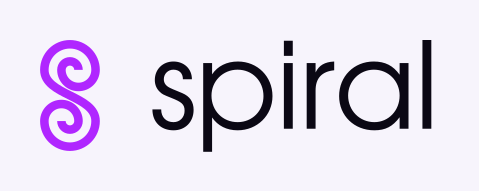
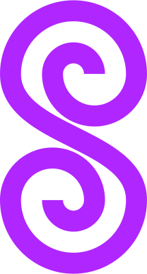
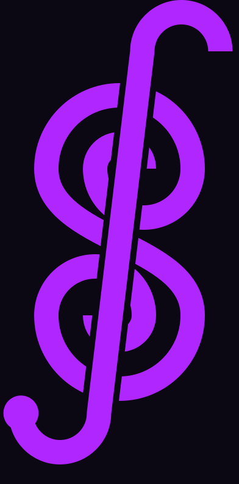
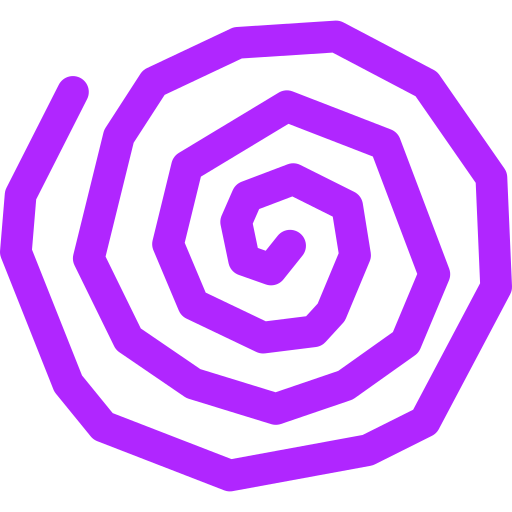

<p align="center">
  <picture>
    <source media="(prefers-color-scheme: dark)" srcset="public/brand/spiral-logo-escuro.svg">
    
  </picture>
</p>

<p align="center">
  <b>ferramentas pequenas para que giram em torno do que você precisa.</b><br>
  tudo roda no seu navegador. nada do que você digita sai da sua máquina.
</p>

## o que é

o **spiral** é um site de ferramentas pequenas, rápidas e sem cadastro, do tipo que a gente precisa vinte vezes por semana no meio de um teste ou de um desenvolvimento: gerar um cpf válido, somar horas, jogar uma moeda, converter um valor.

cada ferramenta faz **uma coisa só**, abre na hora e tem um botão para copiar o resultado.

não existe backend, banco de dados, login nem rastreamento. o site é estático: o navegador baixa a página uma vez e todas as contas acontecem na sua máquina. por isso é de graça para hospedar e não tem nada seu para vazar.

## o conceito

**a letra s é uma espiral**. e uma espiral também lembra uma **clave de sol**, e eu amo música >_<.

<p align="center">
  
  &nbsp;&nbsp;&nbsp;&nbsp;
  
  &nbsp;&nbsp;&nbsp;&nbsp;
  
</p>

- **símbolo principal:** um s construído com duas meias-espirais, uma girando para dentro e outra para fora, com traço
  e vão do mesmo tamanho.
- **variação clave:** o mesmo s, desenhado para lembrar uma clave de sol.
- **espiral à mão:** o rabisco que lembra o botão de trocar o tema.
- **tipografia:** logo e títulos em *TeX Gyre Adventor* (geométrica, de traço limpo). interface em *DM Sans*.

a identidade também aparece no movimento:

- **órbita:** enquanto uma página carrega, uma espiral gira e se desenha.
- **vinil:** a página de erro 404 é um disco com a clave no selo, que você pode arrastar com o mouse para riscar.


## ferramentas

| ferramenta | o que faz | estado |
|---|---|---|
| **calculadora de horas** | soma e subtrai horários (aceita negativos) e guarda o histórico de cada operação | pronta |
| **gerador de CPF** | gera CPFs válidos, com ou sem máscara | pronta |
| **gerador de CNPJ** | gera CNPJs numéricos e o novo formato alfanumérico da Receita | pronta |
| **cara ou coroa** | joga uma moeda justa, uma vez ou várias, e mostra o placar | pronta |
| **morse** | texto para código morse e de volta | em breve |
| **binário** | texto, decimal para binário e de volta | em breve |
| **seletor de cores** | escolhe uma cor e mostra hex, rgb e hsl | em breve |
| **contador de caracteres** | contar letras, palavras, linhas e caracteres com e sem espaços | em breve |
| **calculadora de datas** | calcular diferenças entre datas, somar dias e identificar dias da semana | em breve |


## princípios

- **tudo no navegador.** sem backend, sem envio de dados, sem rede para fazer conta.
- **contas exatas.** horas viram segundos inteiros e dinheiro vira centavos inteiros antes de qualquer cálculo, para nunca aparecer `0.1 + 0.2 = 0.30000000000000004`.
- **aleatório de verdade.** tudo que sorteia usa `crypto.getRandomValues`, nunca `Math.random`.
- **lógica separada da tela.** as regras ficam em arquivos de typescript puro, com testes, e a tela só mostra o resultado.
- **copiar em um clique.** todo resultado tem seu botão de copiar, com plano B quando o navegador bloqueia a área de transferência.
- **claro e escuro.** o tema segue o sistema e lembra sua escolha.


## tecnologias

| | |
|---|---|
| interface | React 19, TypeScript (modo estrito) |
| estilo | Tailwind CSS v4, com as cores do projeto como variáveis |
| build | Vite |
| rotas | React Router (cada ferramenta é carregada só quando abre) |
| testes | Vitest |
| hospedagem | Vercel, direto do GitHub, no plano gratuito |

## rodar na sua máquina

```bash
npm install
npm run dev        # abre em localhost:5173
npm test           # roda os testes da lógica
npm run build      # gera a versão final em dist/
```

## como o projeto é organizado

```
src/
├─ app/             rotas e tema (claro/escuro)
├─ pages/           página inicial, página de ferramenta, 404
├─ components/
│  ├─ brand/        logo, órbita e vinil
│  ├─ layout/       cabeçalho, rodapé, estrutura das telas
│  └─ ui/           botão, campo, copiar, avisos (usados por todas as ferramentas)
├─ tools/
│  ├─ registry.ts   a lista de ferramentas (único lugar para registrar uma nova)
│  └─ <ferramenta>/ logic.ts, logic.test.ts, a tela .tsx e o index.ts
├─ hooks/           pequenos ganchos (ex.: guardar no navegador)
├─ lib/             funções puras compartilhadas (aleatório, área de transferência)
└─ styles/          cores e fontes
```

## cores

| cores | escuro | claro |
|---|---|---|
| fundo | `#0B0814` | `#FAF7FF` |
| cartões | `#161024` | `#FFFFFF` |
| texto | `#EDE9FE` | `#1A1128` |
| destaque | `#A855F7` | `#7C3AED` |
| roxo da marca (logo e vinil) | `#B026FF` | `#B026FF` |

o brilho neon aparece só em foco, hover e no botão principal, para o site continuar legível.

## licenças

a fonte TeX Gyre Adventor segue a GUST Font License (`src/assets/fonts/GUST-FONT-LICENSE.txt`).